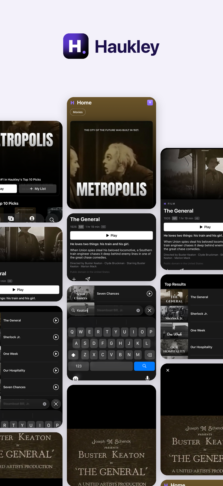
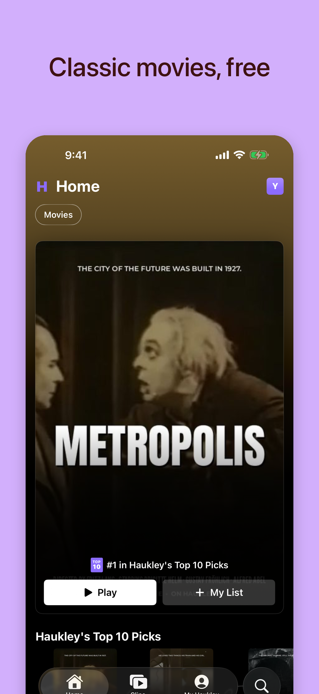
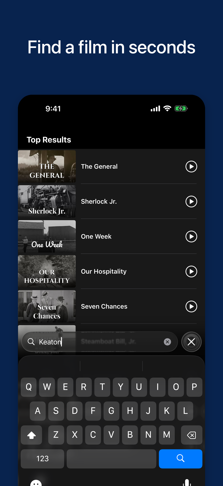
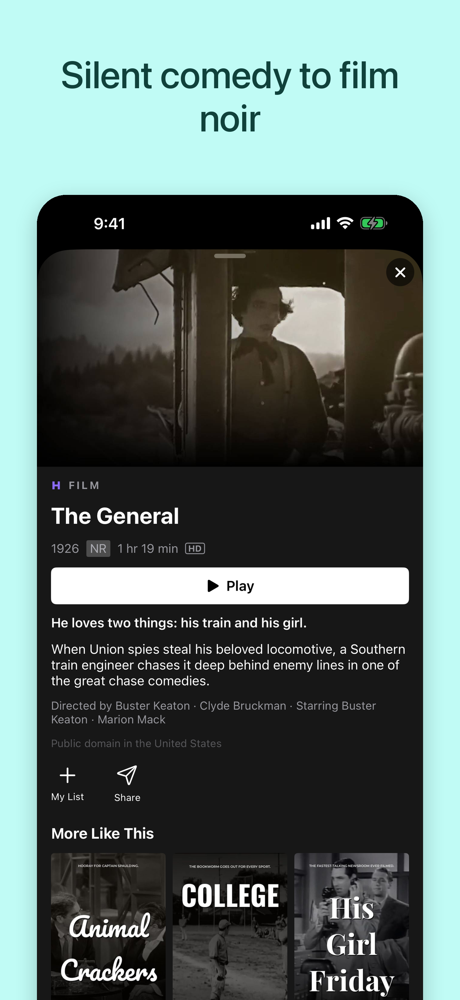
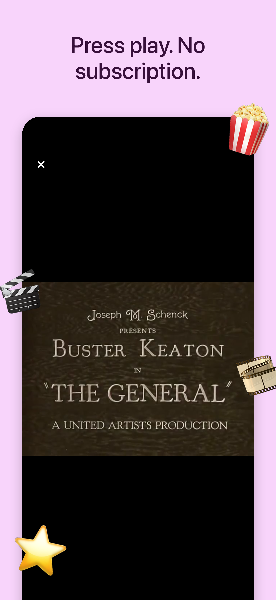
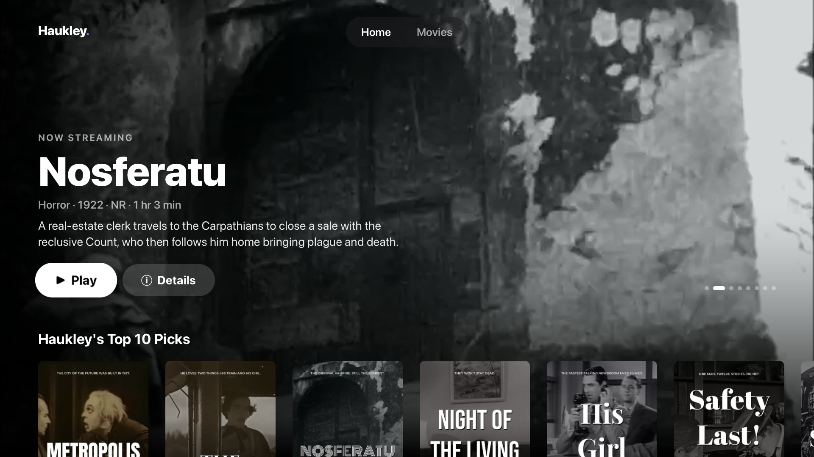

<h1 align="center"> Haukley </h1> <br>
<p align="center">
  <a href="https://haukley.com/">
    
  </a>
</p>

<p align="center">
  Free movies and shows. No subscription. Built with SwiftUI, React Native and BrightScript.
</p>

<p align="center">
  <a href="https://apps.apple.com/us/app/haukley/id6815405240">
    
  </a>
  <br><a href="https://haukley.com/"><b>haukley.com</b></a>
</p>

## Table of Contents

- [Introduction](#introduction)
- [Features](#features)
- [Feedback](#feedback)
- [Build Process](#build-process)
- [iPhone](#iphone)
- [Roku](#roku)
- [Ads and the Filmmaker Revenue Split](#ads-and-the-filmmaker-revenue-split)
- [haukley.com](#haukleycom)
- [Roku Search Feed](#roku-search-feed)
- [Art](#art)
- [Fire OS Gotchas](#fire-os-gotchas)

## Introduction

Haukley is a free, ad-supported streaming service for classic movies, silent comedy, film noir, Pioneers of Black Cinema and NASA documentaries. There is no subscription: press play and watch.

**Available on the web and for iPhone, with TV apps built from the same catalog.**

<p align="center">
  
</p>

## Features

A few of the things you can do with Haukley:

* Watch classic films and shows free, with no subscription
* Browse a home screen with a featured title, Top 10 rows and Continue Watching
* Swipe through a vertical feed of clips to find something to watch
* Search the library and keep a list of titles for later
* Pick up where you left off, with a profile for each person
* Watch on a TV: one React Native codebase runs on Apple TV, Fire TV and Android TV, with separate apps for Roku, LG and Samsung
* For filmmakers: every ad is counted per film, so revenue can be shared with the people who made it

<p align="center">
  
  
  
  
</p>

<p align="center">
  
</p>

## Feedback

Feel free to [file an issue](https://github.com/divinedavis/Haukley/issues/new). Feature requests are always welcome. You can also write to hello@haukley.com.

## Build Process

The TV app (Fire TV, Android TV and Apple TV) is a [react-native-tvos](https://github.com/react-native-tvos/react-native-tvos) project at the repo root; its native project is still named `StreamTV`.

```bash
npm install

# Fire TV over Wi-Fi ADB (Developer Options → ADB debugging on the TV)
scripts/firetv.sh 192.168.1.155

# Apple TV simulator
cd ios && bundle install && bundle exec pod install && cd ..
xcodebuild -workspace ios/StreamTV.xcworkspace -scheme StreamTV -configuration Release \
  -sdk appletvsimulator -derivedDataPath ios/build CODE_SIGNING_ALLOWED=NO build
```

## iPhone

Native SwiftUI app in `iphone/` (XcodeGen), bundle `com.haukley.app`, iOS 18+.
Home (hero card, filter chips, Top 10 rows, Continue Watching), Clips (vertical preview feed),
Search, My Haukley (profile switcher, My List), title sheet with episodes, and an AVPlayer
with Google IMA ads logged per film as platform `ios`.

```bash
.venv/bin/python scripts/make_ios.py                 # bundle catalog + art
cd iphone && xcodegen generate
SIM_UDID=<iPhone sim> scripts/smoke_test.sh          # cold-launch check
SIM_UDID=<iPhone sim> scripts/ship.sh                # UI tests, archive, TestFlight upload
```

`ship.sh` uploads to TestFlight; it never creates an App Store version or submits for review.
App Store Connect secrets live in `iphone/scripts/asc-config.env` (gitignored).

## Roku

```bash
.venv/bin/python scripts/make_roku.py   # -> roku/dist/Haukley-roku.zip (must stay under Roku's 4 MB cap)
```

Row lineup and streams live in `scripts/rows.json`, shared with the React Native app.

Install on a Roku without a developer account (sideload):
1. On the Roku remote press **Home ×3, Up ×2, Right, Left, Right, Left, Right**, accept the agreement, set a password, and note the IP shown.
2. On a computer on the same Wi-Fi, open `http://<roku-ip>`, sign in as `rokudev` with that password.
3. Upload `Haukley-roku.zip` and click **Install with zip**.

A Roku beta app (invite link, up to 20 testers) needs a signed `.pkg`, which can only be made on a real
Roku in developer mode (`genkey`, then the Packager page at `http://<roku-ip>`). `scripts/roku_package.sh` does install + package + download with the key already on the owner's Streaming Stick.

Emulator check: `brs-node` (`npx -p brs-node brs-cli -e -s snap.png roku/dist/Haukley-roku.zip`) runs the SceneGraph UI
and takes ECP key presses. It has no video output, so playback only shows on a real Roku.

Certification features (Roku requirements):
- **Deep linking**: `Main(args)` and `roInput` hand `{contentId, mediaType}` to `MainScene.deepLink`.
  contentId is a title id (`night-line`) or an episode id (`borough-e3`). movie / episode /
  shortFormVideo / tvSpecial play directly (resuming any bookmark); series / season open the title
  page; unknown ids stay on Home. Test in the emulator: `npx -p brs-node brs-cli -k contentId=borough-e3,mediaType=episode <zip>`.
- **Bookmarks**: position saved per title/episode in the registry, kept 60 days (Roku minimum is 30),
  cleared under 10 s or past 95%. The title page shows "Resume … / Play from Beginning".
  Unit tests: `npx -p brs-node brs-cli components/Content.brs tests/bookmarks_test.brs` (from `roku/`).
- **Captions**: the Video node applies the global caption settings and its options (*) menu covers
  On / Off / On replay / On mute; HLS-embedded captions work as-is, and a title's `captions` URL
  in `scripts/catalog.json` is side-loaded as a SubtitleTrack.
- **RAF is OFF** (1.0.3, 2026-10-11): the store listing is non-monetized until Partner Payouts enrollment works; restore from commit 30d81eb (see PlayerTask.brs) and set Monetization back to ads.

Roku gotchas: the emulator ignores `font:BoldSystemFontFile` at custom sizes, so the app bundles Poppins
(OFL) in `roku/fonts`; `scaleToZoom` crops the pre-faded backdrops, so posters use `scaleToFill`.

## Ads and the Filmmaker Revenue Split

- `scripts/ads.json` holds the ad tag and tracking endpoint for every platform. The tag is
  Google's public IMA test VMAP (pre-, mid- and post-roll); replace it with the Google Ad
  Manager tag once the account exists. Each request carries `title_id`, so the ad server can
  report revenue per film. Trailers play without ads.
- Fire TV / Android TV / Apple TV use Google IMA via react-native-video
  (`useExoplayerIMA` in `android/build.gradle`, `$RNVideoUseGoogleIMA` in the Podfile, plus a
  `patches/` fix for a tvOS-only PiP compile error). Roku uses RAF in `roku/components/PlayerTask`.
- Every ad start/completion is logged to Supabase project `axgxpwgbpgcqjxoqwtnv` (free org
  "StreamTV") in `ad_events`. Apps log via the rate-limited RPC `POST /rest/v1/rpc/log_ad_events`
  (one event or an array; <=20/call, <=100/session, <=300/hour per IP) and cannot touch the
  table directly. **Only events with a server-signed playback ticket count** (0014): each
  player calls `POST /rest/v1/rpc/start_playback {title_id, episode, platform}` when it opens
  (-> `{session_id, token}`, HMAC key in the `private` schema, 120/hour per IP) and sends
  `token` + a per-event `seq` with every ad event. Verified = valid token < 8 h old, new
  `(session, event, seq)` (retries dropped), <= 2 + seconds_since_start/10 per event type,
  <= 150 per IP per title per day. Tokenless events (shipped apps: iPhone 1.0.1, Fire TV 1.0,
  LG/Samsung 1.0) are stored with `verified = false` and never paid on. Reads and payout math need the secret key
  (macOS Keychain `supabase-secret-streamtv`). Schema: `supabase/migrations/`.
- Monthly report: `GET /rest/v1/monthly_ad_counts`; estimated payouts:
  `POST /rest/v1/rpc/estimated_payouts {"p_month":"2026-09-01","p_net_cpm":10}`.
- Android drops the IMA `STARTED` event for the first ad after a cold start, so
  `FIRST_QUARTILE` backs it up (counted once per ad).

## haukley.com

Static site in `web/` (home, /filmmakers/, /privacy/, /terms/, /support/), shared `site.css` + `site.js`.
Subpages are assembled from `web/_src/` with `python3 web/_src/build.py`. Deploy:
`rsync -az --exclude _src --exclude beta web/ root@104.236.120.144:/var/www/haukley/`.
The launch-list forms insert into Supabase `waitlist` (insert-only for the public key).
Email forwards (Namecheap) to the owner's Gmail: hello@, support@, films@, privacy@, ads@haukley.com.

## Roku Search Feed

`.venv/bin/python scripts/make_roku_feed.py` -> `web/roku/search-feed.json` (+ `web/img/feed/`),
validated against Roku's schema (`scripts/roku/search-feed.schema.json`). Ids match the Roku app's
deep links. Placeholder content: don't register it with Roku until real titles are in.

Content acquisition notes (outreach, licensing research, term sheet) are business-private and
are not part of this repository; scripts that read or write them use a local, git-ignored
`docs/content/` folder.

## Art

`scripts/catalog.json` is the source of truth for titles. Regenerate posters, cards,
backdrops and episode stills with:

```bash
python3 -m venv .venv && .venv/bin/pip install pillow requests
.venv/bin/python scripts/make_posters.py
```

## Fire OS Gotchas

- Bundled images must be `@2x` or Android upscales them 2x on 320dpi TVs and runs out of bitmap memory.
- Gradient overlay PNGs didn't render; fades are baked into the backdrops instead.
- Native-driven opacity animations stall after a view is hidden; the hero fade uses the JS driver.
- Video renders on a hardware plane, so `adb screencap` shows black during playback.
